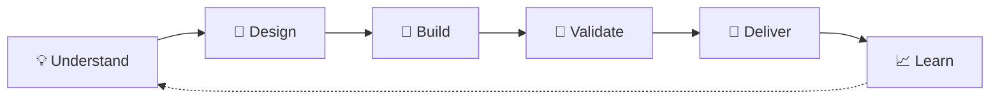

# 👋 Hi, I'm Amitesh Anand!

### ⚡ Software Engineer · 🎨 Frontend Infrastructure · 🧩 Design Systems · 🤖 Applied AI

**I build interfaces people love to use, platforms teams love to build on, and experiments that explore what's next.**

🏗️ **Caterpillar** · Previously **EPAM Systems** & **Cognizant**

[🚀 Explore My Repositories](https://github.com/iamitesh?tab=repositories) · [🌐 Engineering Portfolio](https://github.com/iamitesh/amitesh-portfolio)

---

## ✨ What I Build

<table>
<tr>
<td width="50%" valign="top">
<h3>🎨 Frontend Platforms</h3>

React, TypeScript, Web Components, micro-frontends, and architecture that helps teams move faster.

</td>
<td width="50%" valign="top">
<h3>🧩 Design Systems</h3>

Component libraries, tokens, documentation, accessibility, and consistent experiences at scale.

</td>
</tr>
<tr>
<td valign="top">
<h3>🤖 AI-Powered Interfaces</h3>

Generative UI, structured outputs, agent workflows, RAG, and design-system-aware experiences.

</td>
<td valign="top">
<h3>⚙️ Reliable Engineering</h3>

Typed contracts, testing, CI/CD, performance, authentication, and observable behavior.

</td>
</tr>
</table>

## 🔄 My Engineering Workflows

*From an idea to something people can actually use.*

<table>
<tr>
<td width="50%" valign="top">
<h3>🧱 Design System Flow</h3>

🎯 User needs → 🎨 Design tokens → 🧩 Components → ♿ Accessibility → 📚 Documentation

Reusable foundations, consistent UX, easier adoption.
</td>
<td width="50%" valign="top">
<h3>🤖 Generative UI Flow</h3>

💬 User intent → 📜 Typed schema → 🛡️ Validation → 🧩 UI components → ⚡ Interaction

Structured, inspectable output instead of unpredictable interfaces.
</td>
</tr>
<tr>
<td valign="top">
<h3>🚀 Product Delivery Flow</h3>

💡 Problem → 🧭 Architecture → 💻 Prototype → 🧪 Tests → 🚢 Iterate

Practical trade-offs, dependable implementation.
</td>
<td valign="top">
<h3>🔬 Research Flow</h3>

❓ Question → 🧫 Experiment → 📊 Evaluation → 📝 Findings → 🔁 Refine

Evidence first; proposals and results clearly distinguished.
</td>
</tr>
</table>

<strong>🗺️ See the end-to-end workflow diagram</strong>

## 🚀 Featured Projects

<table>
<tr>
<td width="50%" valign="top">
<h3>🧩 <a href="https://github.com/iamitesh/GenUi">GenUI Studio</a></h3>

<strong>🎨 Generative UI · 🧪 Playground</strong>

Exploring Google's A2UI protocol with Adobe React Spectrum: schemas, bindings, local state, validation, and safe component rendering.

👉 <a href="https://github.com/iamitesh/GenUi">Explore repository</a>

</td>
<td width="50%" valign="top">
<h3>💬 <a href="https://github.com/iamitesh/ui-with-ai">UI with AI</a></h3>

<strong>🤖 Conversational UI · 🛠️ Experiments</strong>

Making chat more interactive with Material UI cards, charts, comparisons, forms, and actions alongside text.

👉 <a href="https://github.com/iamitesh/ui-with-ai">Explore repository</a>

</td>
</tr>
<tr>
<td valign="top">
<h3>🔬 <a href="https://github.com/iamitesh/Agentic-Lib">NeuroResearch Agent</a></h3>

<strong>🧠 Research Tools · 🏗️ Application Project</strong>

A documented Next.js + FastAPI approach to discovering, organizing, ranking, and briefing neuroscience research.

👉 <a href="https://github.com/iamitesh/Agentic-Lib">Explore repository</a>

</td>
<td valign="top">
<h3>🧠 <a href="https://github.com/iamitesh/affective-belief-persistence">Affective Belief Persistence</a></h3>

<strong>🔍 Agent Memory · 🧪 Research Framework</strong>

Offline, reproducible experiments about how memory and evidence affect observable language-model agent behavior.

👉 <a href="https://github.com/iamitesh/affective-belief-persistence">Explore repository</a>

</td>
</tr>
<tr>
<td valign="top">
<h3>⚛️ <a href="https://github.com/iamitesh/QuantsnQuantum">Quants × Quantum</a></h3>

<strong>📚 Learning · 🔭 Interdisciplinary Research</strong>

An evidence-led guide connecting quantum computing, quantitative finance, learning paths, and project ideas.

👉 <a href="https://github.com/iamitesh/QuantsnQuantum">Explore repository</a>

</td>
<td valign="top">
<h3>🌐 <a href="https://github.com/iamitesh/amitesh-portfolio">Engineering Portfolio</a></h3>

<strong>🧑‍💻 My Work · 📂 Project Hub</strong>

My professional background, engineering interests, and the projects I build and explore independently.

👉 <a href="https://github.com/iamitesh/amitesh-portfolio">Explore repository</a>

</td>
</tr>
</table>

> 🔒 **Also exploring privately:** Self Astrologer (interactive astrology learning), along with early developer-tool and product ideas. Private projects are not presented here as public repositories.

## 🔭 What's on My Radar?

| Direction | Current curiosity |
| --- | --- |
| 🪄 **Generative interfaces** | Turning conversations into predictable cards, charts, forms, and actions |
| 🤖 **Agentic engineering** | Specifications, tool use, validation, evaluation, and human review |
| 🧭 **Inspectable systems** | Explicit state, typed contracts, reproducible workflows |
| 💡 **Independent products** | Developer tooling, travel, education, health tech, and productivity |

<strong>🧪 Explore more early-stage initiatives</strong>

| Area | Example explorations |
| --- | --- |
| 🧩 Developer tools | Prism UI, Design System ADLC, FDE, Lit Atoms, UI Seeds |
| 🗺️ Travel & mobility | NavBuddy, RouteSage, Travel Planner |
| 🧠 Health & knowledge | Health Twin, Multilingual RAG, AI/ML Learnings |
| 📚 Business & learning | Legal Mod, Evolve with AI, ADT Scheduler |

*These are private or early-stage initiatives, not claims of commercial launch.*

## 🧰 My Toolbox

| | Technologies |
| --- | --- |
| 🎨 **Frontend** | JavaScript, TypeScript, React, Next.js, HTML, CSS |
| 🧩 **UI systems** | Lit, Web Components, Figma, Storybook, design tokens |
| 🏗️ **Architecture** | Vite, Webpack, Nx, Module Federation, REST, GraphQL |
| 🧪 **Quality** | Jest, Playwright, accessibility, performance, CI/CD |
| ☁️ **Cloud & identity** | Azure, AWS, Entra ID, MSAL |
| 🤖 **AI exploration** | MCP, RAG, model APIs, structured outputs, agent evaluation |

<strong>📦 More repositories & learning experiments</strong>

**🧠 Foundations:** [JavaScript practice](https://github.com/iamitesh/JS-Practice-Bubble) · [React practice](https://github.com/iamitesh/REACT-Practice-Bubble) · [Algorithms](https://github.com/iamitesh/JS-Algorithm-and-DS) · [Testing](https://github.com/iamitesh/react-testinglib)

**💻 UI & application experiments:** [React dashboard](https://github.com/iamitesh/react-dashboard) · [Micro-frontends](https://github.com/iamitesh/microftontend) · [MCP exploration](https://github.com/iamitesh/model-context-protocol) · [Build Fixer](https://github.com/iamitesh/Build-Fixer)

Some repositories are learning exercises, early prototypes, or upstream forks—not finished products.

---

### 💭 My North Star

**Make complex systems easier to build, easier to understand, and more useful to people.**

🛠️ **Build to understand. Share so others can build further.**

[📂 Browse Projects](https://github.com/iamitesh?tab=repositories) · [🌐 Visit Portfolio](https://github.com/iamitesh/amitesh-portfolio)

Personal projects and views are my own. Employer work is described at a general level; independent projects do not imply employer endorsement.

